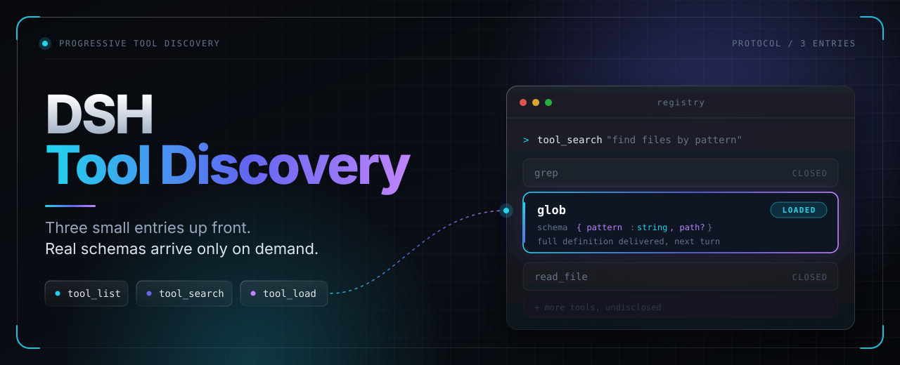

<div align="center">
  

  # DSH Tool Discovery

  **Four small entries and the initial tool set up front; other tools' real schemas arrive on demand.**

  [中文](README.md) | English

  [](https://www.npmjs.com/package/dsh-tool-discovery)
  [](LICENSE)
  [](plugin/docs/10-store-compatibility.md)

  [Quick start](#quick-start) · [The four entries](#the-four-entries) · [Configuration](#configuration) · [Verify it yourself](#verify-it-yourself) · [Design documents](plugin/docs/README.md)
</div>

---

> This README describes the working tree with manifest `0.6.0`: from this version **only DSH Core 0.2.2-rc.1+ is supported** — the legacy projection path (frozen wire, cache epochs, trusted records, the PTC toggle, description compaction) is removed entirely. The [current contract](plugin/docs/00-current-contract.md) consolidates current parameters, state and boundaries.

## Feature preview

### Only the essentials on the first turn

The first request carries just the four fixed entries, a short summary per category, and the full schemas of the default initial set. Other ordinary tools stay undisclosed and take no context.

### Picked tools appear on the next turn

`tool_load` admits the tools and runs nothing; disclosure and execution both start on the following turn, with the definitions the catalog currently holds.

### Retract what you no longer need

`tool_unload` removes admitted tools from the next request's declarations; revocation and version changes likewise become uncallable immediately — disclosure is retracted, not left executable.

---

## Why you need it

| Without it | With it |
|---|---|
| Every registered tool's full JSON Schema is injected on the first request, whether the task needs it or not | The first request carries four small entries, a bounded category summary, and full schemas for the default initial set (DSH core tools and the current preset's retained tools); other tools' real native schemas appear in the **next** turn after explicit selection |
| A finished tool still lingers in the context forever | `tool_unload` retracts disclosure and execution from the next request, freeing declaration space |
| Guessing which category holds which tool | `tool_search` returns top-K candidate cards (short purpose + ref/revision), `tool_list` pages complete names; neither changes the active set |
| No answer to "what is active right now?" | `tool_load`/`tool_unload` return immediate receipts; the `view: "state"` projection lists `selected` / `invalidated` |

## The four entries

This is a DSH plugin. On the first request the model sees the four entries below plus a short
summary of each capability category, **plus the default initial set**: DSH's own core tools (the
manual baseline) and the tools registered by the current agent's own preset, which is retained by
default. Other ordinary tools are not disclosed up front.

| Entry | Answers | Changes what is active? |
|---|---|---|
| `tool_list` | What tools are discoverable in this category? | No |
| `tool_search` | Which tool suits this task? | No |
| `tool_load` | I want these tools. | Yes (admit) |
| `tool_unload` | I no longer need these tools. | Yes (retract) |

`tool_load`/`tool_unload` never run the target tool; disclosure and executability both take effect
from the next request — the current step's tool set is already fixed, so a freshly loaded tool cannot
be called in the same step. Outside the initial/framework exceptions, reaching for an unadmitted tool
is refused. Admissions persist across restarts when `storageDomain` is available (aligned against the
current catalog revision); without it they last for the session's lifetime.

## Admission is the single source of truth

Disclosure and execution read the same admission set: after `tool_load` the tool is both disclosed
and callable from the next request; after `tool_unload` it is both gone and uncallable — there is no
"visible but uncallable" or "callable but invisible" drift. Tools an agent registers into its own
scope cannot be masked by the host and may be disclosed, but by default they still need admission to
execute (`gateOwnScopeTools`).

Disclosure is not execution permission. A disclosed tool still goes through the host's own
approval, sandbox, and authorization checks on every call, exactly as if it had never been mediated
by this plugin.

Progressive disclosure is about context, not speed: a request that carries only what the model is
likely to use does not have to carry everything the host could have offered. The kernel holds no
tools of its own and never bypasses the host.

## Quick start

```sh
# CLI Web-profile example; replace web with the target and give the named tarball URL
dsh plugin --profile web add \
  "dsh-tool-discovery@https://github.com/KouzakiUmi/dsh-tool-discovery/releases/download/<build-tag>/dsh-tool-discovery.tgz"
```

1. Install and enable the bundle, then reload or restart for the host side to pick it up
   (refreshing the page alone does not guarantee a host upgrade).
2. Open **Settings → Tool discovery** — the plugin's own page: optional feature switches, the
   application-wide tool catalog (filter, checkboxes, **Restore DSH default**), and advanced
   budget / language fields.
3. Back in a session the four entries are live. Nothing else changes: every tool call keeps
   going through DSH's own approval, sandbox, and permission chain.

`<build-tag>` is a commit-derived release tag such as `build-80216ba3effa`. Full install/update
rules — npm package for Node projects, tag pinning, CLI-vs-Core version caveats — are in
[Install and update](#install-and-update). Configuration knobs are in
[Configuration](#configuration).

---

# Technical documentation

## Requirements

- DSH Core **`>=0.2.2-rc.1`** — the install-admission range declared by `engines.dsh`.
  `dshReleases` marks `0.2.2-rc.1` as `compatible` and every earlier release as `incompatible`;
  later 0.2.2 versions are not individually verified and may fail at runtime if contracts
  change. The matrix and one-time Profile record are in
  [STORE compatibility](plugin/docs/10-store-compatibility.md).
- The native **`@deepseek-ai/schemastery`** peer is required for the config surface and the settings
  page. Without it the discovery domain still runs normally, but there is no Config and the plugin
  logs `ConfigUnavailable` instead of silently pretending a settings page exists.
- Native and PTC sessions share one admission path: the same masks govern the SDK projection inside `run_code`; there is no separate compatibility toggle.
- **One active agent per session.** Concurrent agents in a single session are not supported,
  because a request cannot be attributed unambiguously.
- Node `^22.19.0 || >=24.0.0`.

## Permissions and external dependencies

DSH STORE requires every plugin to disclose what it can reach before installation. This is the
complete list for this plugin — nothing here is inferred from "we did not find it":

| Surface | Behaviour |
|---|---|
| Files (read) | At activation it reads the active profile's patch file to pick up the host's own `locale.preference`, and otherwise falls back to `$DSH_HOME/desktop-locale.json` (**keyed by profile name**). Any failure (missing file, bad JSON, unknown language) falls back to `en` with one log line. Setting the `locale` config field to `zh`/`en` **pins the language and skips both reads entirely**. |
| Files (write) | No direct filesystem writes. Durable state goes through the host's `@deepseek-ai/dsh-storage-domain` service: one record per session holding this session's admitted **tool names + version digests**. It contains no file contents, no message bodies, and no credentials. |
| Session data | Does not read session events; recovery aligns the admission record against the current catalog. |
| Network | None. The plugin issues no outbound request of any kind. |
| Commands | None. No child process, shell, or dynamic code evaluation. |
| Credentials | None. It does not read `process.env`, does not touch keychains or account state, and stores no secret. |
| Logging | Diagnostics only (session id, state, reason). Tool arguments, file contents, and message bodies are never logged. |

**Runtime dependency: `zod`.** The host storage API (`@deepseek-ai/dsh-storage-domain`) accepts a zod
schema, so admission persistence declares `zod` as a real dependency. When it cannot be resolved or
the storage service is absent, admissions degrade to **in-memory only** (the session still runs; they
just do not survive a restart) — nothing is faked.

**Host peers.** `@deepseek-ai/dsh` and `@deepseek-ai/dsh-tools` are required.
`@deepseek-ai/dsh-storage-domain` (admission persistence) and `@deepseek-ai/dsh-home-paths` (interface
language path) are optional: when absent, the corresponding feature degrades honestly instead of
being simulated.

**Scope of the promise.** This plugin is built and verified for a **single user on a single
profile** — the installation it is mounted into. It does **not** claim to hold a boundary across a
shared, multi-user, remote, or multi-tenant deployment: session admission records
are trusted *inputs*, and whoever can write them can influence what a session may execute. Treat it
as a disclosure gate inside one profile, not as a wall between users. If you need that wall, put it
in the host (per-user accounts, sandboxing, filesystem permissions), not here.

## Install and update

The GitHub Release build asset remains available for DSH profile installs: a green `main` run packs
the tree and publishes `dsh-tool-discovery.tgz` on a commit-derived `build-<sha>` release (a run
whose commit is already superseded is skipped, so an older commit is never re-published as the
newest release). That asset is a **build artifact, not an acceptance statement**; what a version
covers and what it deliberately does not claim is recorded in
[current status](plugin/docs/05-current-status.md).

The package has been published to npm since version `0.2.1`. Future stable `v<version>` tags that
match `package.json` run the npm publish job after the portable tests and repository checks pass.
GitHub Actions authenticates to npm with OIDC and npm generates provenance; no npm write token is
stored in GitHub. See [Publishing to npm](#publishing-to-npm) for the release steps.

The commands above and below are **public-CLI Web-profile examples**; `web` is not an inferred installation target.
DSH NEXT Desktop profiles are managed by its bundled Desktop CLI, not the globally npm-installed public CLI.
Desktop users should first verify the installation-owned CLI, actual profile and `plugin --help`, then follow that version's quit/reopen requirements. Do not copy an internal bootstrap path from documentation, run bare npm/pnpm inside a managed profile, or edit its lockfiles.
CLI/shell versions do not establish the actual Core version. References: [CLI plugin management](https://github.com/deepseek-ai/deepseek-harness/blob/master/apps/cli/reference/README.md) and [Desktop ownership](https://github.com/deepseek-ai/deepseek-harness/blob/master/apps/desktop/README.md). Public master documentation is not proof for every installed version.

```sh
# first install — name the package, then the full tarball URL
dsh plugin --profile web add \
  "dsh-tool-discovery@https://github.com/KouzakiUmi/dsh-tool-discovery/releases/download/<build-tag>/dsh-tool-discovery.tgz"

# update an installed copy — the same name@URL form
dsh plugin --profile web update \
  "dsh-tool-discovery@https://github.com/KouzakiUmi/dsh-tool-discovery/releases/download/<build-tag>/dsh-tool-discovery.tgz"
```

Because the tag carries the commit, a later build never replaces an older one, and two builds can
legitimately share one manifest version — maintainers bump `version`, CI does not — so pin the tag
whose commit you tested, always give the package name explicitly, and read the version from the
release name (`v<version> · <sha>`) or from the manifest inside that tarball instead of assuming
what `main` currently says.

For a Node project, install the public package from npm with `npm install dsh-tool-discovery`. The
DSH profile installation commands above continue to use the DSH CLI and a GitHub Release asset.

## Configuration

The plugin has no required configuration, and every field is a **flat root field** of the plugin's
own config namespace — there is no `progressiveDiscovery` wrapper in the current native config
surface:

```jsonc
{
  // "alwaysVisible": ["read", "grep"],  // omit entirely to keep the DSH defaults
  "initialToolsEnabled": true,  // optional manual initial injection; preserves the configured list
  "alwaysAllowPresetTools": true, // retain tools declared by the current bound preset
  "gateOwnScopeTools": true,    // own-scope registrations must also be admitted before executing
  "frameworkRetained": [],  // trusted framework-mandated names the mask must keep
  "categoryConfig": {},     // localised category cards
  "tolerantLoadProtected": true, // tolerate loading an already-resident tool (idempotent)
  "respectAlwaysVisible": false, // false (default): core tools are auto-enrolled; true: your list is the ceiling
  "budgets": null,          // see below; null means no overrides
  "locale": "auto"          // "auto" follows the desktop language; "zh"/"en" pins it and skips the file read
}
```

`alwaysVisible` **replaces the manual initial list**, rather than adding to its defaults. Omitting
it keeps the DSH core-tool defaults. Preset retention is separate: when `alwaysAllowPresetTools`
is on, the current bound preset's native-visible registered tools are unioned with this manual list.
To start with only the four discovery entries, set `alwaysAllowPresetTools: false` and either
`initialToolsEnabled: false`, or both `alwaysVisible: []` and `respectAlwaysVisible: true` (unless explicit framework retention also applies).
The four entries cannot be removed. Names that are not native-visible in the current agent are
not granted merely because the settings catalog contains them.

### Deprecated configuration keys

`ptcCompatibility`, `compactBuiltinToolDescriptions`, `compactBuiltinToolOverrides`,
`requireTrustedEpoch`, `requireTrustedEpochForSubagents` and `allowMissingSessionQuery` have
**no effect** on 0.2.2-rc.1+: their subsystems were removed with the legacy projection path. The
fields stay in the config schema so existing files are not rejected; the settings page labels them
deprecated/removed.

### Settings page: the Tool discovery home

With the native `schemastery` peer present, the plugin contributes its own top-level settings page —
**Settings → Tool discovery** (a `settings.section` contribution, the plugin's home in the GUI). It
is laid out as an at-a-glance home rather than a bare form:

- **Status strip** — live counts from the same metadata the panel edits: fixed entries, catalog
  tools, initial-list size, and how many names are *not registered* in the application catalog or
  *unconfirmed*.
- **Four entries reference cards** — `tool_list` / `tool_search` / `tool_load` / `tool_unload`: what
  each answers, what it returns, and which one changes the active set, plus the admission semantics above.
- **Optional feature switches** and the **manual initial tool list** — an application-wide
  registration catalog, including preloaded presets even before any session exists. The catalog
  reads all current registration layers, not session eligibility, discovery/loading state, or
  outbound headers. It supports a name filter, checkboxes and **Restore DSH default**; selection
  writes only the root `alwaysVisible` field. Missing names are labelled **not registered in the
  application catalog**, never as an execution failure. If the installed SDK cannot supply a
  complete registry, absent names are **unconfirmed**. Global registration does not promise
  execution permission in every session.
- **Advanced** — interface language, JSON editors for `budgets` and `categoryConfig`, and
  `frameworkRetained` shown read-only.

Every switch and field:

- **Inject initial tools** (`initialToolsEnabled`, default `true`): disabling preserves the configured list but stops automatic initial injection; `tool_load` still works. This switch and the list reconcile on the **next request**; existing on-demand admissions remain until unloaded.
- **Always allow tools specified by the preset** (`alwaysAllowPresetTools`, default `true`): retain only tools registered by the exact preset revision the current agent joined, intersected with its native-visible capabilities. Other presets and later agent-only tools do not become trusted. Independent of manual injection; reconciles on the next request. It preserves the initial set, not arbitrary execution or native permission bypass.
- **Gate the agent's own registrations** (`gateOwnScopeTools`, default `true`): tools registered into the agent's own scope cannot be masked and may be disclosed; when on, own-scope names in the catalog also need `tool_load` admission before executing; when off, own-scope names outside the catalog execute freely.
- **Interface language** (`locale`, default `auto`): `auto` reads the host's own `locale.preference` from the active profile patch, and otherwise falls back to the desktop language file — any failure (missing, bad JSON, unsupported language) falls back to `en` and is always logged, never silent. `zh`/`en` pins the model-visible copy language and **skips those reads entirely**. Not a volatile field: a change takes effect when the plugin reloads.
- **Make the initial list an exact set** (`respectAlwaysVisible`, default `false`): **off with initial injection enabled**, DSH core tools that the current scope actually offers are auto-enrolled and can be called without a load — fewer round-trips. This only recognizes names in the maintained core list; an unknown upstream addition still needs a [baseline review](plugin/docs/12-core-tools-maintenance.md). **On**, your `alwaysVisible` (plus preset retention) is the *ceiling*: a core tool you left out has to be loaded like any other tool. Refusing it is not a deadlock — an omitted core tool is simply **not in the protected baseline**, so one ordinary `tool_load` admits it on the next request (`tolerantLoadProtected` is about something else: re-loading a tool that is *already* resident stays idempotent).
- Eligibility, protocol receipts and the admission gate remain enforced. The four discovery entries cannot be disabled.

The page also exposes **idempotent baseline loading** (`tolerantLoadProtected`) and **exact initial
list** (`respectAlwaysVisible`) switches. The advanced JSON editors list supported keys and reject
malformed JSON, unknown keys, invalid limits and incomplete category copy before saving. Small
budget limits may block tasks or add round-trips. `frameworkRetained` is displayed read-only, not
editable here.

An omitted `alwaysVisible` displays the actual schema defaults. All mutation controls are disabled during loading, read-only state or an in-flight save to prevent concurrent overwrites. Restore-default is disabled without metadata and avoids unchanged writes. Rejected writes show an error, not a success notice. Non-volatile fields reload the plugin when saved; the page warns about this. This is the native config surface, with no legacy wrapper/UI compatibility promise. The standalone real-DOM probe uses a controlled persistence channel, not the active user's configuration, and does not imply online installation or deployment.

### Budgets: hard caps are off by default

An omitted `limit` uses 20/5 narrowed by any explicit `maxListLimit`/`maxSearchLimit`; an explicit oversized limit is rejected. Byte caps cover the entire successful JSON envelope for all four list views and search, including empty results. Error envelopes and host wrappers are outside this success cap. State may only trim `invalidated` diagnostics with a marker, never `selected`. See the [current contract](plugin/docs/00-current-contract.md).

By default this plugin **adds no extra risk thresholds**. Every hard cap — tool count, batch size,
schema bytes, page size, result bytes, query length, skill bytes — is `null`, meaning *disabled*.
Set a cap by giving it a positive integer; set it back to `null` to disable it. `null` is used
rather than `Infinity` because `Infinity` cannot survive JSON.

```jsonc
"budgets": {
  "maxActiveTools": null,        // e.g. 12 to cap how many tools stay loaded
  "maxActiveSchemaBytes": null,  // e.g. 49152 to cap the frozen schema bytes
  "maxLoadBatch": null,          // e.g. 4 to cap tools per single load
  "maxListLimit": null,          // e.g. 20 to cap the page size
  "maxSearchLimit": null,
  "maxListResultBytes": null,
  "maxSearchResultBytes": null,
  "maxQueryCodePoints": null,
  "maxSkillBytesPerLoad": null
}
```

`maxActiveTools` and `maxActiveSchemaBytes` count **only on-demand selections** — loaded, frozen, or
pending disclosure. They do not count the initial `alwaysVisible` baseline, which is injected by the
host and is not this plugin's budgeted surface.

Turning a cap **on** is a real trade-off, not a free safety win:

- **It blocks work.** Exceeding a cap rejects the *new* items. Already-disclosed tools are never
  evicted to make room — nothing is unloaded to fit, under any configuration.
- **It costs turns.** The model has to split the same work into several smaller loads, adding model
  round-trips, latency, and total cost.
- **It can discourage the next load from fitting, and that pressure may prompt an early compaction.**
  When the disclosed set outgrows a cap, the available responses are to raise the cap, turn it off,
  or compact sooner — and compacting sooner than the workload warrants costs context
  re-establishment. None of these is forced; whoever set the cap keeps full control of it.
- **Limits are not optimisation.** A cap that makes a task fail or take longer has not made
  anything cheaper. Default recommendation: leave them off, and set one only when you have a
  concrete reason (a deployment that must bound prompt growth, for example).

**A starting profile, if you do want to bound prompt growth.** This plugin exists to keep the tool
block small; nothing is ever evicted to make room, so without a cap an eager model can keep loading
tools until a compaction. If you would rather the plugin hold the line than rely on the model
self-managing, start here and adjust from observed behaviour:

```jsonc
"budgets": {
  "maxActiveTools": 12,          // how many on-demand tools may stay resident at once
  "maxActiveSchemaBytes": 49152, // 48 KiB of schema for those tools
  "maxLoadBatch": 4,             // tools per single load call
  "maxQueryCodePoints": 512,     // reject absurdly long search queries
  "maxListResultBytes": 4096     // bound name listings *and* the state projection
}
```

The first three are **guard rails**: they are the mechanism that actually delivers the plugin's
promise, and because nothing is ever unloaded, turning them off means a long session only grows. The
last two are **interaction bounds**: they protect the host from one pathological call rather than
changing ordinary usage. `maxListResultBytes` now also covers `view: "state"`: when it would be
exceeded, the diagnostic `invalidated` list is trimmed first (with an explicit
`invalidatedTruncated` marker) — `selected` is never trimmed — and only if even an
empty one does not fit does the call fail with `BUDGET_EXCEEDED`.

What stays bounded even with every cap disabled: the default page size (`defaultListLimit`, 20),
the default candidate count (`defaultSearchLimit`, 5), pagination, and the TTLs. Disabling a hard
cap does not make output unbounded — it only means there is no extra ceiling beyond those defaults.

`maxListResultBytes` / `maxSearchResultBytes` measure the UTF-8 bytes of the **complete successful
JSON envelope**, including arrays, cursors, truncation flags and `nextAction`. Empty pages and zero-hit
searches must fit too. If even the minimum successful response cannot fit, the call returns
`BUDGET_EXCEEDED` without cutting names, refs or error text. Error envelopes themselves and any
additional host message wrapping are outside these caps.

`initialSchemaTargetTokens` and `maxInitialBytes` are historical target values. Nothing in the
current code path enforces them, so they are **not** a measured guarantee of a 2K initial budget.

## Verify it yourself

Run from the repository root:

```sh
npm test                          # unit suite — trust the output of this command
npm run test:composition          # composition gates (real DSH Loader) — trust the output
npm run test:all                  # both, in order
npm run check                     # package identity + docs consistency (needs only Node)
```

Most of the unit suite needs nothing but Node. Two files —
`plugin/tests/unit/client.test.mjs` and `plugin/tests/unit/settings.test.mjs` — are
host-bound: they import React and `@deepseek-ai/schemastery` at module top level out of an
installed DSH, resolved through `plugin/contracts/install-resolver.mjs`. Run the suite where
such an installation is present; if it is not at the default location, point
`DSH_INSTALL_ROOT` at it.

CI's portable unit job therefore runs everything except exactly those two files, which it
reports as skipped with the reason. That job is the portable subset, not a passing full `npm test`. The exact exclusion command is in the
[development guide](plugin/README.md#portable-unit-subset). Host tests need a resolvable installation tree;
an ASAR archive alone does not satisfy this resolver. Historical DOM probes are not rerun by the portable job.

Counts move as suites are added, so they are deliberately not written down here. Treat the actual
output of these two commands as the source of truth; a number printed in this file would drift.
`npm run clean` is a separate deletion operation, not a test prerequisite; inspect its scope first.

`test:composition` runs every `plugin/tests/composition/gate-*.test.mjs` file against a real Loader:
adapter gates, lifecycle, resume, mask contract, settings, tool churn and the admission gate. A new
gate file is picked up by the glob; nothing else needs editing.

The composition suites boot a real Cordis Loader against an installed DSH, so they need the host to
be present. They resolve packages from that installation; if it is not at the default location,
point `DSH_INSTALL_ROOT` at it. These commands install and restart nothing, and they do not touch
your DSH profile; they do create temporary session files under `plugin/fixtures/tmp/` (ignored by
Git) and remove them when each test process exits. Set `DSH_KEEP_TMP=1` to keep them for debugging;
`npm run clean` removes any leftovers.

The quality tooling is published, but the full suite needs the frozen scoring dataset, which is
not published — so it does not complete on a public checkout. See
[current status](plugin/docs/05-current-status.md) for what that dataset covers and where it
stands.

## Get the source

The source version on this branch is **`0.6.0`**. npm publication and provenance must be checked in
[the registry](https://www.npmjs.com/package/dsh-tool-discovery); a GitHub build release alone does
not establish npm availability. Which version a download carries is decided by its tarball manifest,
not by assuming that `main`, the release name and this document always agree.

```sh
git clone https://github.com/KouzakiUmi/dsh-tool-discovery
cd dsh-tool-discovery
```

It is plain JavaScript with no build step. The manifest declares a runtime `dependencies` entry,
`zod` (`^4.4.3`) — the admission record table is handed to the host's storage domain as a zod
schema — and declares the host packages it needs as `peerDependencies`, provided by the DSH
installation. Nothing is vendored, and there is no build step that could paper over a missing host
package.

## Publishing to npm

This describes the current [repository workflow](.github/workflows/ci.yml), not verified registry-side authorization or a successful publication:

| Item | Current source |
|---|---|
| Trigger | A stable `v<version>` tag exactly matching the manifest; prerelease tags do not run this job |
| Gates | Portable unit and repository checks |
| GitHub environment | **`npm`**, not “none” |
| Runtime | Node 24; the official Trusted Publishing minimum for the publishing client is npm 11.5.1+ |
| Identity | The job grants `id-token: write` and uses OIDC; the workflow does not read `NPM_TOKEN` |
| Publish command | `npm publish --provenance --access public` |

Maintainers must separately verify the npm Trusted Publisher's repository, workflow filename `ci.yml`, environment and permission to publish directly. Saving that configuration does not test it.
Check the source version, tag, payload, provenance and actual registry result individually; an old account setup record or the CI file does not prove current authorization.
Reference: [npm Trusted Publishers](https://docs.npmjs.com/trusted-publishers).

The GitHub `build-<sha>` asset uses a separate workflow path. Neither kind of publication establishes Profile installation or an active GUI.

## Architecture and what it costs

Admission-based disclosure keeps off-task tools out of the first request, and `tool_unload` can
actively free declaration space; known tool names can be batch-loaded. That is the design intent — **no measured saving in context or tokens is claimed**, and
none should be read into it.

The other side of the trade-off: an initial list made too small increases model round-trips and
rediscovery work. Defaulting to DSH's core tools, while leaving the list editable, is a deliberate
balance — not a promise of a 2K initial budget.

## What this is not yet

- **Source implementation is not full product acceptance.** npm, GitHub build assets, STORE listing, Profile installation and an online GUI are separate states. Check actual evidence for each; historical disposable-Profile operations are in [compatibility evidence](plugin/docs/10-store-compatibility.md).
- **The current GUI is unaccepted, not historically never DOM-tested.** Earlier records describe controlled React/Chromium probes; they were not reverified or rerun in this round. VM tests, historical DOM records and the current online page are different evidence layers; see [current status](plugin/docs/05-current-status.md).
- **No measured token or latency benefit is claimed.** Smaller disclosure is the design goal; additional round-trips and end-to-end task time require measurement.
- **Retrieval metrics remain incomplete.** Fixing category-only false positives does not establish Recall@K, negative-query precision or model selection rates. Category-only queries may need browsing.
- **Only rc.1 is declared within 0.2.2.** Green regressions on the rc.1 unpacked anchor do not establish every 0.2.2 version, real providers, GUI or installation coverage.

## Further reading

- [Design documents](plugin/docs/README.md) — the current contract, architecture, historical protocol drafts, acceptance
  matrices and evidence status.
- [Contributing](CONTRIBUTING.md) · [Security](SECURITY.md)

## License

MIT — see [LICENSE](LICENSE).
