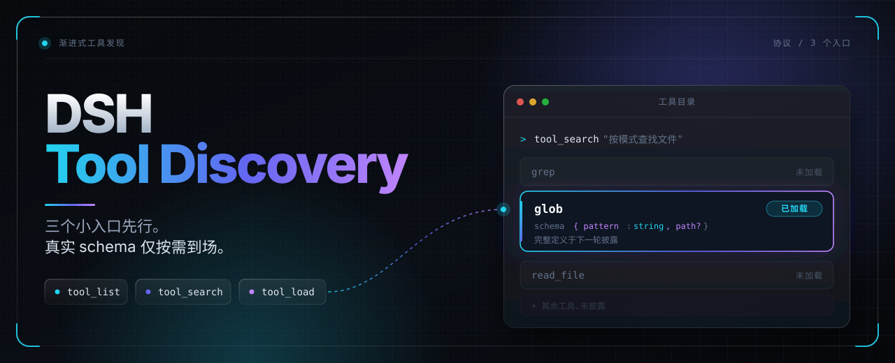

<div align="center">
  

  # DSH Tool Discovery

  **三个小入口与初始工具集合在前，其它工具的真实 schema 按需到场。**

  中文 | [English](README.en.md)

  [](https://www.npmjs.com/package/dsh-tool-discovery)
  [](LICENSE)
  [](plugin/docs/10-store-compatibility.md)

  [快速开始](#快速开始) · [三个入口](#三个入口) · [配置](#配置) · [自行验证](#自行验证) · [设计文档](plugin/docs/README.md)
</div>

---

> 本文对应 manifest `0.4.4` 的主线构建源码。后续修复以 `build-<sha>` 区分，不代表已包含在 npm `0.4.4` 正式版中。现行参数、状态与边界集中在[当前实现契约](plugin/docs/00-current-contract.md)，旧冻结稿与实验记录按其日期阅读。下列功能预览以 native 路径为主；PTC 默认旁路，显式兼容仍有 SDK 冻结缺口。

## 功能预览

### 首轮只带必要的东西

首轮请求里只有三个固定入口、每类能力的简短摘要，以及默认初始集合的完整 schema。其它普通工具首轮不披露，不占上下文。

### 选中之后，下一轮才出现

`tool_load` 只记录选择、不执行工具；披露发生在下一轮，模型读到的定义与选择一致。

### 已披露的不被悄悄改写

同一缓存周期内，已披露的内容与顺序只增不改，宿主侧工具升级不会在会话中途改写模型已读过的定义。只有成功压缩才会重置周期。

**冻结承诺目前限于 native。** 同名新 schema 与冻结定义冲突时，`tool_load` 返回
`COMPACTION_REQUIRED`，须等待用户或 DSH 成功压缩后再加载；相同 schema 的绑定重连或技能换版仍可加载。
原生冷恢复保留本周期曾实际披露的旧定义，但不因此恢复失效权限。可选 PTC 兼容目前仍重渲染当前 SDK，
**不保证逐字冻结或稳定追加，也不保证跨重启 SDK 冻结**；该缺口尚未修复。

---

## 为什么需要它

| 没有它 | 有了它 |
|---|---|
| 每个已注册工具的完整 JSON Schema 都在首轮注入，无论任务是否用得上 | 首轮带三个小入口、有界类别摘要，以及默认初始集合的完整 schema（DSH 核心工具与当前 preset 保留的工具）；其它工具的真实原生 schema 在模型显式选定后的**下一轮**出现 |
| 宿主侧工具升级可以在会话中途悄悄改写模型已经读过的定义 | 一个缓存周期内已披露的 wire **只增不改**——首披露时记录的定义就是它一直被发送的定义 |
| 哪个类别里有什么工具，全靠猜 | `tool_search` 给 Top-K 候选卡（短用途 + ref/revision），`tool_list` 给分页的完整名称；两者都不改变激活集合 |
| 「现在到底激活了哪些工具」没有答案 | `tool_load` 回执是版本化的 canonical 记录；`view: "state"` 投影列出 `selected` / `advertised` / `invalidated` |

## 三个入口

这是一个 DSH 插件。首轮请求里模型看到下面三个固定入口，外加每个能力类别的一段简短摘要，
**以及默认初始集合**：DSH 自带的核心工具（手动基线）与当前 agent 自己 preset 登记的工具
（默认保留）。其它普通工具首轮不披露。

| 入口 | 回答的问题 | 改变激活集合？ |
|---|---|---|
| `tool_list` | 这个类别里有哪些可发现的工具？ | 否 |
| `tool_search` | 哪个工具适合当前任务？ | 否 |
| `tool_load` | 我要用这些工具。 | 是 |

`tool_load` 不会执行目标工具，它只记录选择，披露发生在下一轮。初始/框架保留等例外之外，未按需加载的工具会被拒绝；卸载根本
不是模型的动作——`action: "unload"` 会被拒绝，因此两次成功压缩之间已披露集合只增不减。

## 两条不变量框住整个设计

- **健康 native 缓存周期内，已披露内容与顺序只增不改。** 加载不会移动或改写已披露条目：首次披露时记录的
  wire 会被持续原样发送，因此宿主侧工具升级不会静默改写模型已经读过的定义。
- **只有成功压缩才会重置周期。** 手动 `/compact` 与 DSH 自动压缩都算；失败、取消或没有摘要的压缩
  不算。

冻结 wire 不等于执行权限。已披露的工具每次调用仍要经过宿主自身的审批、沙箱与授权检查，与它从未
被本插件中介过完全一样。

渐进式披露解决的是上下文，不是速度：只携带模型大概率会用到的内容，就不必携带宿主本可以提供的
全部内容。内核自身不持有任何工具，也从不绕过宿主。

## 快速开始

```sh
# CLI Web profile 安装示例；将 web 换成实际目标，先写包名再给完整 URL
dsh plugin --profile web add \
  "dsh-tool-discovery@https://github.com/KouzakiUmi/dsh-tool-discovery/releases/download/<build-tag>/dsh-tool-discovery.tgz"
```

1. 安装并启用 bundle，按部署方式重载或重启（只刷新页面不保证 Host 升级）。
2. 打开 **设置 → 工具发现**——插件自己的主页：可选功能开关、应用全局工具目录（按名称筛选、
   勾选、**恢复 DSH 默认**），以及高级的预算 / 语言字段。
3. 回到会话，三个入口即已生效。其余一切不变：每次工具调用仍走 DSH 自身的审批、沙箱与权限链。

`<build-tag>` 是提交级 Release 标签，例如 `build-80216ba3effa`。完整的安装 / 更新规则（Node 项目的
npm 包、标签钉住、CLI 与 Core 版本的区别）见[安装与更新](#安装与更新)；配置项见[配置](#配置)。

---

# 技术文档

## 环境要求

- DSH Core **`>=0.2.1-alpha.1`**——这是所有 `@deepseek-ai/dsh` 与 `@deepseek-ai/dsh-*` peer 的
  安装准入范围。宿主升到更新的发行版时仍允许安装，不会因版本钉死而被直接拒绝。这不是兼容声明：
  `dshReleases` 仍只把 `0.2.1-alpha.1` 与 `0.2.1-alpha.2` 标为 `compatible`，其它版本仍未测试，
  契约变化时仍可能在运行时失败。逐版本矩阵与一次性 Profile 记录见
  [上架与兼容声明](plugin/docs/10-store-compatibility.md)。
- 原生 **`@deepseek-ai/schemastery`** peer 是配置面与设置页的前提。缺少它时发现内核仍正常运行，
  但没有 Config，插件会记录 `ConfigUnavailable`，而不是假装存在一个设置页。
- **native** 是完整披露路径。非 native 会话不在插件激活期被一律拒绝：PTC 默认旁路，开启 `ptcCompatibility` 后进入下一轮 `run_code` SDK；不保证 native 式冻结，不把展示模式静默改成另一种。
- **每会话单个活动 agent**。单会话内多 agent 并发不受支持——请求无法无歧义地归属。
- Node `^22.19.0 || >=24.0.0`。

## 权限与外部依赖

DSH STORE 要求插件在安装前列清它能触及什么。以下是本插件的完整清单——不以「没搜到」代替事实：

| 面 | 行为 |
|---|---|
| 文件（读） | 激活时读当前 profile 的 patch 文件，取宿主自己的 `locale.preference`；没有再回落到 `$DSH_HOME/desktop-locale.json`（该文件**以 profile 名为键**）。任何失败（文件缺失、JSON 损坏、语言未知）都回落 `en` 并留一行日志。把配置项 `locale` 设为 `zh`/`en` 会**钉住语言并完全跳过这两次读取**。 |
| 文件（写） | 不直接写文件系统。持久状态经宿主 `@deepseek-ai/dsh-storage-domain` 服务落盘：每个会话一条记录，内容是 epoch 身份加该会话允许常驻的**工具名名单**，不含文件内容、消息正文或凭据。 |
| 会话数据 | 通过公开的 `ctx.sessionQuery` 只读回放**本会话**事件（一次折叠 + 增量），用于恢复会话已 load 过的集合。 |
| 网络 | 无。插件不发起任何出站请求。 |
| 命令 | 无。不使用子进程、shell 或动态代码求值。 |
| 凭据 | 无。不读 `process.env`、不碰钥匙串或账号状态、不保存任何密钥。 |
| 日志 | 仅诊断信息（会话 id、状态、原因）。工具参数、文件内容与消息正文永不入日志。 |

**运行时依赖：`zod`。** 宿主存储 API（`@deepseek-ai/dsh-storage-domain`）接收 zod schema，因此可选的可信周期功能把 `zod` 声明为真实依赖。解析不到时插件**不**伪造内存存储：会话落入终态 `STORAGE_UNAVAILABLE` 并停止发请求。其余功能——三入口、目录、投影、门禁——不依赖它。

**宿主 peer。** `@deepseek-ai/dsh` 与 `@deepseek-ai/dsh-tools` 必需；`@deepseek-ai/dsh-storage-domain`（可信周期）与 `@deepseek-ai/dsh-home-paths`（界面语言路径）为可选：缺失时对应功能**诚实降级**，不做模拟。

**承诺范围。** 本插件面向**单用户、单 profile**（即它被挂载的那一份安装）构建与验证。它**不**承诺
在共享、多用户、远程或多租户部署中充当边界：会话历史与可信周期存储是**受信任的输入**，能写它们的人
就能影响某个会话可以执行什么。请把它当作单个 profile 内的披露门禁，而不是用户之间的墙。若你确实
需要那堵墙，请把它放在宿主侧（分账号、沙箱、文件系统权限），而不是这里。

## 安装与更新

DSH profile 安装仍可使用 **GitHub Release 构建资产**：`main` 绿跑会把仓库打包，在提交级
`build-<sha>` Release 上发布 `dsh-tool-discovery.tgz`（若已有更新的 `main` 提交，旧一次运行会直接跳过，
不会把旧提交重新发布成最新资产）。该资产是**构建产物，不是验收声明**；某个版本覆盖什么、明确
**不**宣称什么，见[当前状态](plugin/docs/05-current-status.md)。

本包自 `0.2.1` 起已发布到 npm。之后推送与 `package.json` 版本匹配的稳定 `v<version>` 标签，通过便携测试和
仓库检查后，npm 发布任务会自动运行。GitHub Actions 通过 OIDC 向 npm 验证身份，npm 同时生成 provenance；
GitHub 不保存 npm 写入令牌。发布步骤见[发布到 npm](#发布到-npm)。

上述与下面的命令是**公共 CLI 的 Web profile 示例**，`web` 不是对实际安装目标的推断。
DSH NEXT Desktop 的 profile 由随包 Desktop CLI 管理；全局 npm 的公共 CLI 不能冒充该入口。
桌面用户应先核验目标安装提供的 CLI、实际 profile 与 `plugin --help`，按目标版本要求退出/重开应用；不要复制文档中的内部 bootstrap 路径，也不要在受管 profile 裸跑 npm/pnpm 或手改锁文件。
CLI/桌面壳版本不代替实际 Core 版本。官方参考：[CLI 插件管理](https://github.com/deepseek-ai/deepseek-harness/blob/master/apps/cli/reference/README.md)、[Desktop 所有权](https://github.com/deepseek-ai/deepseek-harness/blob/master/apps/desktop/README.md)。公开 master 文档不是每个已安装版本都通过验证的证明。

```sh
# 首次安装 —— 先写包名，再给完整 tarball URL
dsh plugin --profile web add \
  "dsh-tool-discovery@https://github.com/KouzakiUmi/dsh-tool-discovery/releases/download/<build-tag>/dsh-tool-discovery.tgz"

# 更新已安装副本 —— 同样是 name@URL 形式
dsh plugin --profile web update \
  "dsh-tool-discovery@https://github.com/KouzakiUmi/dsh-tool-discovery/releases/download/<build-tag>/dsh-tool-discovery.tgz"
```

`<build-tag>` 是提交级 Release 标签，例如 `build-80216ba3effa`。标签里带着提交号，因此新构建不会
覆盖旧构建；两次构建也可能共用同一个清单版本——`version` 由维护者 bump，CI 不改——所以请钉住你测过的
那个标签对应的提交，始终显式写出包名，并以 Release 名（`v<version> · <sha>`）或该 tarball 内的清单
为准判断它到底是哪个版本，而不是假设 `main` 与本文一致。

Node 项目可通过 `npm install dsh-tool-discovery` 从 npm 安装。本节上面的 DSH profile 安装命令仍由 DSH CLI
从 GitHub Release 资产安装。

## 配置

插件没有必需配置，所有字段都是插件自身配置命名空间里的**扁平根字段**——在当前的原生配置面上
**没有** `progressiveDiscovery` 外层包装：

```jsonc
{
  // "alwaysVisible": ["read", "grep"],  // 整项省略即保持 DSH 默认名单
  "initialToolsEnabled": true,  // 可关闭手动初始注入，不删除已配置名单
  "alwaysAllowPresetTools": true, // 保留当前实际绑定的 preset 所登记工具
  "ptcCompatibility": false, // 默认旁路 PTC；开启后发现进入下一轮 run_code SDK
  "requireTrustedEpoch": false, // 高级严格校验，默认不阻断存量会话
  "requireTrustedEpochForSubagents": false, // 仅主严格开关也开启时对子代理强制校验
  "frameworkRetained": [],  // 投影必须保留的可信框架工具名
  "categoryConfig": {},     // 本地化类别卡
  "tolerantLoadProtected": true, // 容忍重复加载已在册的工具（幂等）
  "respectAlwaysVisible": false, // false（默认）：核心工具自动常驻；true：你的名单就是上限
  "budgets": null,          // 见下；null 表示不覆盖
  "locale": "auto"          // "auto" 跟随桌面语言；写 "zh"/"en" 可钉住语言并跳过读文件
}
```

`alwaysVisible` 是**替换手动初始名单**，而不是追加默认项；省略它即保持 DSH 核心工具默认值。
preset 保留是独立来源：`alwaysAllowPresetTools` 开启时，当前实际绑定 preset 所登记且原生作用域允许
的工具会与手动名单合并。若只需要三个发现入口，应设 `alwaysAllowPresetTools: false`，并设
`initialToolsEnabled: false`，或同时设 `alwaysVisible: []` 与 `respectAlwaysVisible: true`（显式框架保留仍可能贡献工具）。三个入口不可删除。
设置页全局目录中存在某工具，不意味着它会被授予所有会话。

### 设置页：工具发现主页

在原生 `schemastery` peer 在场时，插件贡献自己的顶层设置页——**设置 → 工具发现**（一个
`settings.section` 贡献，即本插件在 GUI 里的主页）。它按「一眼看懂的主页」组织，而不是一张裸表单：

- **状态条**——与面板所编辑的同一份元数据上的实时计数：常驻入口、目录工具、初始名单大小，
  以及多少名字**未在应用全局目录登记**或**尚未确认**。
- **三个入口参考卡**——`tool_list` / `tool_search` / `tool_load`：各自回答什么、返回什么、
  哪个会改变激活集合，外加上述两条不变量。
- **可选功能开关**与**手动初始工具名单**——**应用全局登记目录**。目录读取当前全部注册层，包括
  无需创建会话就已预加载的 preset；不读取会话资格、发现/加载状态或历史请求头。支持按名称筛选、
  勾选切换与**恢复 DSH 默认**，勾选只写根级 `alwaysVisible`。完整目录中缺少名字时标注为**未在
  应用全局目录登记**，不断言调用失败；宿主 SDK 无法提供完整目录时，未列出的名字标注为**全局登记
  状态尚未确认**。全局已登记不保证每个会话都具备执行权限。
- **高级**——界面语言、`budgets` 与 `categoryConfig` 的 JSON 编辑器，`frameworkRetained` 只读展示。

每个开关与字段：

- **PTC 兼容**（`ptcCompatibility`，默认 `false`）：关闭时保留宿主 PTC SDK，开启后发现入口与选定工具进入下一轮 `run_code` SDK，下一轮采用。SDK 仍会重新渲染，冻结、稳定追加和跨重启冻结尚未实现；这不是 native 冻结开关。

- **自动注入初始工具**（`initialToolsEnabled`，默认 `true`）：关闭不删除勾选名单，不自动注入这些工具，仍可用 `tool_load` 加载。开关和名单改动在**新会话或成功压缩后**采用，当前周期不改变。
- **永远放行 preset 规定的工具**（`alwaysAllowPresetTools`，默认 `true`）：只读取当前 agent 实际绑定的 preset 修订自身登记、且该 agent 原生目录仍允许的工具。不根据会话 header 中的 preset 名或设置页全局目录授信；其它 preset、后装 agent-only 工具不会被自动放行。与手动注入独立，在新会话或成功压缩后采用；保留初始集合，不绕过原生权限和执行校验。
- **强制可信周期校验**（`requireTrustedEpoch`，默认 `false`）：默认不读写可信周期存储、不因缺少记录或 storageDomain 阻断会话；常驻工具来自当前配置快照，历史出站头不授予资格。开启会重新加载插件，要求持久化周期记录；存量会话缺记录时需要成功执行用户 `/compact`，存储故障也会阻断。关闭后可恢复没有记录的会话，但**不提供严格模式的跨重启名单冻结保证**。
- **对子代理强制可信周期校验**（`requireTrustedEpochForSubagents`，默认 `false`）：只有主严格开关也开启时才生效。默认情况下，宿主运行时拥有的子代理使用配置基线，不读写 epoch 记录，不因缺记录要求 `/compact`，包括已有历史的子会话恢复。身份依据实时父子所有权，不信 header/meta 自称或单纯的持久 fork 血缘；作为顶层恢复的 fork 会话仍受主严格开关约束。该普通设置会重载插件，关闭后可恢复旧子会话，无需伪造压缩。显式开启可能阻断旧子会话；子代理不能代替用户执行 `/compact`。
- **界面语言**（`locale`，默认 `auto`）：`auto` 先读当前 profile patch 里宿主自己的 `locale.preference`，没有再回落到桌面语言文件；任何失败（文件缺失、JSON 损坏、语言不受支持）都回落 `en`，且回落**一定会留日志**、不静默。写 `zh`/`en` 会钉住模型可见文案的语言，并**完全跳过这两次读取**。非 volatile 字段：改动在插件重载后生效。
- **让初始名单成为精确集合**（`respectAlwaysVisible`，默认 `false`）：**关闭**且初始注入开启时，当前 scope 真实提供的 DSH 核心工具会被自动并入常驻名单，且不经 load 即可调用——省一次往返。这里只识别插件维护表中的核心名称；上游新增且未入表的名字仍需[跟版核验](plugin/docs/12-core-tools-maintenance.md)。**打开**后，你的 `alwaysVisible`（加 preset 保留项）就是**上限**：没列出的核心工具必须像别的工具一样先 load。被拒不会死锁——被排除的核心工具**不在受保护的基线里**，一次普通 `tool_load` 就能在下一轮把它放行（`tolerantLoadProtected` 管的是另一件事：**已在名单里**的工具重复 load 保持幂等）。两点注意：已经在严格模式下跑的会话，仍会按它落盘的记录继续放行到下一次用户 `/compact`；本字段非 volatile，改动在插件重载后生效。
- 工具资格、协议回执、历史损坏校验和执行门禁始终有效，不提供关闭这些保护的开关。三个发现入口始终保留。

主页还提供**容忍重复加载初始工具**（`tolerantLoadProtected`）、**精确初始名单**（`respectAlwaysVisible`）开关；高级配置中可选择语言，并编辑 `budgets` 与 `categoryConfig` JSON。JSON 编辑器显示支持的键，在保存前拒绝语法错误、未知键、非法限额和不完整的类别文案；较小预算可能增加往返或阻断任务。`frameworkRetained` 仅只读展示，不可由此页面修改。

省略 `alwaysVisible` 时展示宿主 schema 的实际默认名单。加载中、只读或保存进行中禁用所有修改控件，防止并发写覆盖；元数据缺失时不可恢复默认，名单已经默认时不重复写。保存失败会显示错误，不宣称生效。非 volatile 字段保存会重载插件，页面提供提示。该主页即原生配置面；不承诺旧包装配置或旧版设置 UI 的兼容性。独立浏览器 DOM 探针使用真实渲染器及受控保存通道，不代表在线配置持久化或当前 GUI 已部署新代码。

### 预算：硬上限默认关闭

省略 `limit` 时默认 20/5 会被显式 `maxListLimit`/`maxSearchLimit` 收窄；显式超限仍拒绝。list 四个 view 与 search 的字节限额覆盖完整成功 JSON 外壳，空页也计量；错误与宿主额外包装不受该成功上限保证。state 只可带标记裁 `invalidated`，不裁 `selected`/`advertised`。详见[当前契约的预算说明](plugin/docs/00-current-contract.md#5-预算)。

本插件**默认不额外增加风险阈值**。所有硬上限——工具数量、批次大小、schema 字节、页大小、
结果字节、查询长度、技能字节——默认都是 `null`，即**关闭**。给它一个正整数即启用该项上限；
填回 `null` 即关闭。这里用 `null` 而不是 `Infinity`，因为 `Infinity` 无法在 JSON 中存在。

```jsonc
"budgets": {
  "maxActiveTools": null,        // 例如 12：限制同时加载的工具数
  "maxActiveSchemaBytes": null,  // 例如 49152：限制冻结的 schema 字节
  "maxLoadBatch": null,          // 例如 4：限制单次 load 的工具数
  "maxListLimit": null,          // 例如 20：限制页大小
  "maxSearchLimit": null,
  "maxListResultBytes": null,
  "maxSearchResultBytes": null,
  "maxQueryCodePoints": null,
  "maxSkillBytesPerLoad": null
}
```

`maxActiveTools` 与 `maxActiveSchemaBytes` **只统计按需选择项**——已加载、已冻结或待披露的。它们
不统计初始 `alwaysVisible` 基线，那是宿主注入的，不属于本插件的预算面。

**打开上限是有代价的权衡，不是免费的安全加成：**

- **它会阻断任务。** 超出上限时被拒绝的是**新增项**。已披露的工具在任何配置下都不会被淘汰
  来腾位置——不存在"为了塞进去而卸载"这种行为。
- **它会增加轮次。** 模型必须把同一件事拆成更小的多次 load，代价是更多模型往返、更高延迟、
  更高总成本。
- **它可能给下一次 load 造成压力，并可能诱使用户提前压缩。** 当已披露集合超过上限时，可选的应对
  包括**调高限额、关闭限额**，或压缩得更早一些——而过早的压缩需要重建上下文。这些都不是被迫的，
  限额由设置者完全掌控。
- **限额不等同于优化。** 一个让任务失败或变慢的上限，并没有让任何东西变得更便宜。默认建议保持
  关闭；只有在有明确理由时（例如部署必须约束 prompt 增长）才设置。

**如果你确实想约束 prompt 增长，可以从这组值起步。** 本插件的存在意义就是把工具块压小；而任何
配置下都不会卸载，所以不设上限时，一个积极的模型可以一直 load 到下次压缩。与其依赖模型自律，
不如让插件守住这条线——下面的数值可以先照用，再按实际观察调整：

```jsonc
"budgets": {
  "maxActiveTools": 12,          // 同时在册的按需工具数
  "maxActiveSchemaBytes": 49152, // 这些工具冻结 schema 的上限（48 KiB）
  "maxLoadBatch": 4,             // 单次 load 的工具数
  "maxQueryCodePoints": 512,     // 拒绝异常长的检索词
  "maxListResultBytes": 4096     // 约束名称列表**与** state 投影
}
```

前三项是**护栏**：它们才是这个卖点的执行机制，而既然不会卸载，关掉它们就等于长会话只增不减。
后两项是**交互边界**：保护宿主免受单次异常调用，不改变日常使用。`maxListResultBytes` 现在还覆盖
`view: "state"`——超限时先裁剪诊断性的 `invalidated` 列表（带显式 `invalidatedTruncated` 标记），
`selected` 与 `advertised` 永不裁剪；连空列表都放不下时才以 `BUDGET_EXCEEDED` 明确失败。

即使所有硬上限都关闭，以下仍然有界：默认页大小（`defaultListLimit`，20）、默认候选数
（`defaultSearchLimit`，5）、分页本身，以及各项 TTL。关闭硬上限不会让输出变得无界，只是表示在
这些默认值之上没有额外天花板。

`maxListResultBytes` / `maxSearchResultBytes` 按**完整成功 JSON 外壳**的 UTF-8 字节计量，包含
数组、游标、截断标记和 `nextAction`；空页及零命中也不能越界。连最小成功响应都放不下时返回
`BUDGET_EXCEEDED`，不裁剪名称、ref 或错误信息。该上限不限制错误外壳本身，也不包含宿主另外添加的消息包装。

`initialSchemaTargetTokens` 与 `maxInitialBytes` 是历史目标值，当前代码路径并未强制它们，因此
**不是**"实测保证的初始 2K 预算"。

## 自行验证

在仓库根目录执行：

```sh
npm test                          # 单元测试 —— 以该命令的实际输出为准
npm run test:composition          # 组合门禁（真实 DSH Loader）—— 以实际输出为准
npm run test:all                  # 依次运行以上两者
npm run check                     # 包身份 + 文档一致性检查（只需 Node）
```

单测大部分只需要 Node。其中两个文件依赖宿主：`plugin/tests/unit/client.test.mjs` 与
`plugin/tests/unit/settings.test.mjs` 在模块顶层就通过 `plugin/contracts/install-resolver.mjs`
从已安装的 DSH 里取 React 与 `@deepseek-ai/schemastery`。要在装有该 DSH 的机器上跑完整套件；
安装不在默认位置时用 `DSH_INSTALL_ROOT` 指向它。

因此 CI 的便携单测作业只跑除这两个文件以外的全部用例，并明确把这两个文件按宿主依赖跳过
并给出原因。该作业是便携子集，不等于完整 `npm test` 通过。精确排除命令见[开发指南](plugin/README.md#portable-unit-subset)。
宿主测试解析器需要可正常解析包的安装根，仅存在 ASAR 并不自动满足；历史 DOM 探针也不由便携作业重跑。

用例数会随测试增减而变化，因此这里**刻意不写死数字**。以这两条命令的实际输出为准；写在本文件
里的数字必然过时。`npm run clean` 是额外的删除操作，不是测试前必跑步骤，执行前请核对范围。

`test:composition` 会在真实 Loader 上运行 `plugin/tests/composition/gate-*.test.mjs` 的全部文件：
适配器门禁、生命周期、恢复与 fork、事件 `seq`、缓存周期、设置、工具增减，以及可信周期各套。新增
门禁文件会被 glob 自动纳入，无需改其它地方。详见 [07 · 恢复与 fork 覆盖](plugin/docs/07-lifecycle-recovery-coverage.md)。

组合测试会针对已安装的 DSH 启动真实 Cordis Loader，因此需要宿主在场。它们从该安装解析包；若
安装不在默认位置，请用 `DSH_INSTALL_ROOT` 指向它。这些命令不安装、不重启，也不会改动你的
DSH profile；但会在被 Git 忽略的 `plugin/fixtures/tmp/` 下创建临时会话文件，并在每个测试进程退出时
清除。设置 `DSH_KEEP_TMP=1` 可保留现场用于排查；`npm run clean` 清除任何残留。

质量工装是公开的，但完整跑完需要冻结的评分数据集，而该数据集未公开，因此在公开检出上无法跑完。
该数据集覆盖什么、当前处于什么状态，见[当前状态](plugin/docs/05-current-status.md)。

## 获取源码

本分支的源码版本为 **`0.4.4`**。npm 是否已发布及其 provenance 应以
[registry](https://www.npmjs.com/package/dsh-tool-discovery) 为准，GitHub 构建版存在本身不证明 npm 已发布。
某次下载究竟带哪个版本，以 tarball 内清单为准，不假设 `main`、Release 名与本文始终一致。

```sh
git clone https://github.com/KouzakiUmi/dsh-tool-discovery
cd dsh-tool-discovery
```

纯 JavaScript，无构建步骤。清单里声明了一个运行时 `dependencies` 项 `zod`（`^4.4.3`）——可信周期
记录表要以 zod schema 交给宿主的 storage domain——所需宿主包则声明为 `peerDependencies`，由 DSH
安装提供。项目不做 vendored 副本，也不存在可以拿来掩盖宿主包缺失的构建步骤。

## 发布到 npm

以下描述[仓库工作流](.github/workflows/ci.yml)的当前定义，不证明 registry 端授权或本次发布已经成功：

| 项 | 当前源码 |
|---|---|
| 触发 | 与 manifest 稳定版本完全匹配的 `v<version>` 标签；预发布标签不走此任务 |
| 前置门禁 | portable unit 与仓库检查 |
| GitHub environment | **`npm`**，不是“无 environment” |
| 运行时 | Node 24；Trusted Publishing 的 npm 发布客户端最低要求见官方文档（11.5.1+） |
| 发布身份 | job 授予 `id-token: write`，使用 OIDC；工作流不读取 `NPM_TOKEN` |
| 发布命令 | `npm publish --provenance --access public` |

维护者需另行核对 npm 端 Trusted Publisher 的仓库、工作流文件名 `ci.yml`、environment 和直接发布权限；保存配置本身不验证它能成功发布。
源码版本、标签、载荷、provenance 与 registry 实际结果要逐项核对，不能靠历史账号操作或 CI 文件宣称已配置成功。
官方依据：[npm Trusted Publishers](https://docs.npmjs.com/trusted-publishers)。

GitHub 的 `build-<sha>` 构建资产是另一条流程，不是 npm 发布；二者都不会证明 Profile 已安装或 GUI 已生效。

## 架构与其代价

稳定 wire + 只增不改的披露会减少 prompt 中**不必要的前缀变动**；已知工具名可以批量加载，压缩之后
不会被强制再走一轮检索。这是设计意图——**不声称任何实测的上下文或 token 节省**，也不应从中读出
这类承诺。

另一面是权衡的另一侧：初始名单切得过小会增加模型往返与重新发现的开销。默认采用 DSH 核心工具、
同时保留可编辑，是一个有意识的平衡——不是"初始 2K 预算"的承诺。

## 它还不是什么

- **源码实现不等于完整产品验收。** npm、GitHub 构建资产、STORE、Profile 安装和在线 GUI 是不同状态，应核对各自实际证据；历史一次性 Profile 操作见[兼容记录](plugin/docs/10-store-compatibility.md)。
- **当前 GUI 未验收，不等于历史上从未测过 DOM。** 历史记录记载了旧版本的 React/Chromium 受控探针，本轮未复核或重跑；VM 单测、历史 DOM 记录与当前在线页面不是同一层证据，详见[当前状态](plugin/docs/05-current-status.md)。
- **不声称实测 token 或延迟收益。** 工具披露减少是设计目标，任务往返和总耗时需要单独测量。
- **检索指标未完成。** 类别词误命中已修，不代表 Recall@K、负例误命中率或模型选择率达标；纯类别查询可能需要改用浏览。
- native 恢复、成功压缩和结果乱序已有分层回归；crash/fsync、完整 HMR 与目标新宿主全路径仍需验证。**PTC SDK 冻结缺口仍开放。**

## 延伸阅读

- [设计文档](plugin/docs/README.md)——现行合同、需求与架构、历史冻结规范、验收矩阵与证据状态。
- [贡献](CONTRIBUTING.md) · [安全](SECURITY.md)

## 许可证

MIT —— 见 [LICENSE](LICENSE)。
